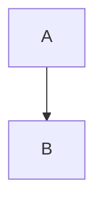

# WebObsidian Agent skill

通过位于 `/api/v1` 的 Agent REST API 操作 [WebObsidian](https://github.com/xnohat/webobsidian)
仓库（Vault）。一切都是使用 API 密钥进行身份验证的普通 HTTP 调用。

## 凭据（每次会话都先读取这些）

凭据位于 **`~/.webobsidian/credentials.json`**：

```json
{ "baseUrl": "https://your-webobsidian.example.com", "apiKey": "wok_xxxxxxxx" }
```

**在会话中的第一次请求之前**，将它们加载到 shell 变量中：

```bash
BASE=$(python3 -c 'import json,os;print(json.load(open(os.path.expanduser("~/.webobsidian/credentials.json")))["baseUrl"].rstrip("/"))')
KEY=$(python3 -c 'import json,os;print(json.load(open(os.path.expanduser("~/.webobsidian/credentials.json")))["apiKey"])')
```

如果 `~/.webobsidian/credentials.json` **不**存在，或某次调用返回 **401**：

1. 向用户索要其 **WebObsidian base URL**（例如 `https://notes.example.com` 或
   `http://host:8787`）及其 **API 密钥**。他们在应用中于
   **Settings → API Keys** 处创建密钥（选择权限范围 `read` / `write` / `search`）。密钥形如 `wok_…`。
2. 保存它（切勿回显密钥）：
   ```bash
   mkdir -p ~/.webobsidian && chmod 700 ~/.webobsidian
   cat > ~/.webobsidian/credentials.json <<JSON
   { "baseUrl": "<BASE_URL>", "apiKey": "<API_KEY>" }
   JSON
   chmod 600 ~/.webobsidian/credentials.json
   ```
3. 通过 health 接口和一次已认证的调用进行验证，然后继续。

**安全规则：** 切勿打印、记录或提交 API 密钥。切勿将其写入仓库（Vault）
笔记中。如果某条命令会将其暴露，请对其进行脱敏。

## 完整性检查

```bash
curl -s "$BASE/api/v1/health"                          # 存活检查，无需认证
curl -s -H "X-API-Key: $KEY" "$BASE/api/v1/tags" | head # 确认密钥可用
```

## 身份验证

在每个 `/api/v1` 请求上以请求头形式发送密钥（两种形式均可）：

```
X-API-Key: wok_xxx
Authorization: Bearer wok_xxx
```

每个密钥的权限范围：`read`、`write`、`search`。超出密钥权限范围的调用会返回 `403`。
受速率限制（默认 120 次请求/分钟/密钥）→ 超出时返回 `429`；请退避并重试。

## 接口参考

所有 `{path}` 值均为 **仓库相对路径**，且必须进行 **URL 编码**（查询使用
`curl -G --data-urlencode`；在 URL 路径中编码包含 `/` 的路径，例如 `Notes/Ideas.md` →
`Notes%2FIdeas.md` 可以被接受，普通的 `Notes/Ideas.md` 也可以正常工作）。

| Method | Path | Scope | Description |
|--------|------|-------|-------------|
| GET | `/api/v1/health` | – | Liveness check |
| GET | `/api/v1/notes?offset=&limit=` | read | List markdown notes (paginated) |
| GET | `/api/v1/notes/{path}` | read | Read a note + parsed metadata |
| PUT | `/api/v1/notes/{path}` | write | Create / overwrite a note — body `{"content":"..."}` |
| PATCH | `/api/v1/notes/{path}` | write | Append — body `{"append":"..."}` |
| DELETE | `/api/v1/notes/{path}` | write | Move note to trash |
| GET | `/api/v1/search?q=&limit=` | search | QMD search (fielded: `tag:`, `path:`, `title:`) |
| GET | `/api/v1/backlinks?path=` | read | Notes linking to a path |
| GET | `/api/v1/tags` | read | All tags with counts |

## 操作示例

```bash
# 列出 10 篇笔记
curl -s -H "X-API-Key: $KEY" "$BASE/api/v1/notes?limit=10"

# 读取一篇笔记（若路径查询值含空格/斜杠请进行 URL 编码）
curl -s -H "X-API-Key: $KEY" "$BASE/api/v1/notes/Welcome.md"

# 创建或覆盖一篇笔记
curl -s -X PUT -H "X-API-Key: $KEY" -H 'Content-Type: application/json' \
  -d '{"content":"# Title\n\nBody written by the agent."}' \
  "$BASE/api/v1/notes/Agent/Generated.md"

# 追加到笔记（不存在则创建）
curl -s -X PATCH -H "X-API-Key: $KEY" -H 'Content-Type: application/json' \
  -d '{"append":"\n- another bullet"}' \
  "$BASE/api/v1/notes/Agent/Generated.md"

# 删除笔记（→ 回收站）
curl -s -X DELETE -H "X-API-Key: $KEY" "$BASE/api/v1/notes/Agent/Generated.md"

# 全文搜索（支持字段查询）
curl -s -G -H "X-API-Key: $KEY" "$BASE/api/v1/search" \
  --data-urlencode "q=tag:idea graph" --data-urlencode "limit=5"

# 某篇笔记的反向链接
curl -s -G -H "X-API-Key: $KEY" "$BASE/api/v1/backlinks" --data-urlencode "path=Welcome.md"

# 所有标签及其计数
curl -s -H "X-API-Key: $KEY" "$BASE/api/v1/tags"
```

## 响应结构

```jsonc
// GET /api/v1/notes/{path}
{ "path": "Welcome.md", "content": "...", "title": "Welcome",
  "frontmatter": { "tags": ["welcome"] }, "tags": ["welcome"], "links": ["Notes/Ideas"] }

// GET /api/v1/search
{ "query": "graph", "hits": [
  { "path": "Notes/Ideas.md", "title": "Ideas", "score": 4.2, "tags": ["idea"], "snippet": "…" } ] }
```

## Obsidian Flavored Markdown（用此方言书写笔记）

该仓库是真正的 Obsidian 仓库（Vault）——用户也会在 Obsidian 应用中打开这些文件，
因此请书写 **Obsidian Flavored Markdown**，而非普通 Markdown。使用 `[[wikilinks]]` 表示
仓库笔记之间的链接（Obsidian 会跟踪重命名）；**仅**对外部 URL 使用 `[text](url)`。

### Properties（YAML frontmatter）
位于笔记的最顶部，在两个 `---` 围栏之间。默认键：`tags`、`aliases`、
`cssclasses`。覆盖写入时保留现有的 frontmatter。

```markdown
---
title: My Note
date: 2024-01-15
tags:
  - project
  - active
aliases:
  - Alternative Name
---
```

### Wikilinks（内部链接）
```markdown
[[Note Name]]                 Link to a note
[[Note Name|Display Text]]    Custom display text
[[Note Name#Heading]]         Link to a heading
[[Note Name#^block-id]]       Link to a block
[[#Heading in same note]]     Same-note link
```

### Block references
在段落末尾附加 `^block-id`；对于列表/引用块，请将 id 单独放在该块之后的一行。
```markdown
This paragraph can be linked to. ^my-block-id
```

### Embeds / transclusion（在 wikilink 前加 `!` 前缀）
```markdown
![[Note Name]]                Embed a whole note
![[Note Name#Heading]]        Embed one section
![[image.png]]                Embed an image
![[image.png|300]]            Embed with width
![[document.pdf#page=3]]      Embed a PDF page
```

### Callouts
```markdown
> [!note]
> Basic callout.

> [!warning] Custom Title
> Callout with a custom title.

> [!faq]- Collapsed by default
> Foldable callout (`-` starts collapsed, `+` starts expanded).
```
常见类型：`note`、`tip`、`info`、`warning`、`danger`、`success`、`failure`、`question`、
`example`、`quote`、`bug`、`abstract`、`todo`。

### Tags
```markdown
#tag            行内标签
#nested/tag     层级标签
```
字母、数字（不可作首字符）、`_`、`-`、`/`。标签也可写入 frontmatter 的 `tags:`。

### Tasks
```markdown
- [ ] Pending task
- [x] Completed task
```

### 其他语法
```markdown
==highlight==   **bold**   *italic*
Footnote[^1].          [^1]: Footnote text.       Inline footnote.^[Inline text.]
Visible %%hidden inline comment%% text.            $e^{i\pi}+1=0$  (inline math)
```
````markdown
$$\frac{a}{b} = c$$         (block math, KaTeX)


````

## 编辑规则

- 当只是添加内容时，**优先使用 `PATCH` 追加**，而非 `PUT`，以免覆盖笔记。
- 在覆盖写入现有笔记之前**先读取**，除非用户明确想要全新替换；
  保留其 frontmatter 和格式。
- 路径**区分大小写**，笔记必须包含 `.md` 扩展名。
- 当你引用另一篇笔记时，使用链接（`[[Other Note]]`）而非书写裸名称——
  这样可以保持图谱和反向链接完整。

## 故障排查

- `401` → 密钥缺失/无效 → 重新运行上文的凭据流程。
- `403` → 密钥缺少所需的权限范围 → 请用户创建一个具有所需
  权限范围（`read`/`write`/`search`）的密钥。
- 某篇笔记返回 `404` → 路径/大小写错误，或它位于 `.trash` 中。
- `429` → 触发速率限制 → 等待并重试。
- Connection refused / TLS error → 确认 base URL 且服务器可达。
