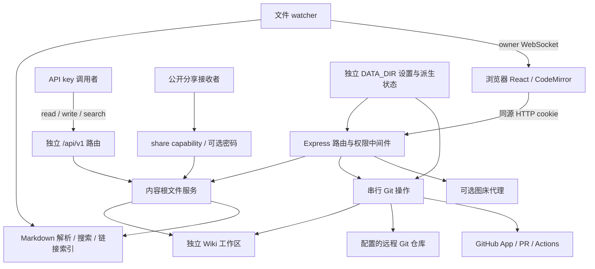

# NKUStudy 编辑器架构核查

审计日期：2026-10-22。源码基线：`e2201591c02ecb96e4d42d6adbd0644f1a15b40a`；当前工作分支：`nkustudy-dev`。本文按当前源码建立架构、权限与有效资源模型，服务于从 `feat/qut-fork` 适配 NKUStudy 的设计决策；不表示已经接入真实 Wiki、部署或通过业务验收。

## 1. 范围、依据与证据等级

- **直接核查**：当前程序仓库的 React/Vite、Express、文件/索引/渲染、Git/GitHub App、上传、分享、插件、Electron 和工作流源码。文中 `path:line` 指向上述基线的源码；依赖和配置声明不能代替实际环境证据。
- **主控提供的本地验证**：Mac arm64、Node 22.23.4，在隔离 `git archive` 副本执行 `npm ci --ignore-scripts`、typecheck、build：安装退出0，组合命令最后退出0确认build成功；typecheck日志无错误，但未单独记录退出码（见evidence/README.md）。它不是 Linux AMD64、Docker 运行、真实服务、部署、真机或业务验收证据。
- **主控提供的安全复现**：匿名 guest 写入允许路径后，经索引解析触发 `gray-matter` 默认 JavaScript engine，在隔离服务进程中设置无害 `globalThis.__NKU_AUDIT_MARKER`，已证明服务器上下文执行。未运行系统命令或访问凭据。这是上线前阻断项；复现、分级及其他权限/上传/Git 结论统一见 [security-audit.md](security-audit.md)，本文不复制漏洞步骤或假定问题已修复。
- **用户已确定的边界**：本次仅审计与文档；程序仓库与未来 Wiki 内容仓库分开；不接触 Production、真实 Wiki 或秘密，不推送，不实现未确认需求。
- **尚未确定**：未来 Wiki 仓库、目录结构、默认编辑/审核分支、公开编辑产品规则、维护者身份体系、图床、部署与发布责任人。

本文的独立架构核查不等同于逐文件完整安全审计覆盖；安全覆盖与发现以安全报告为准。

## 2. 组件与数据流



| 组件 | 入口 / 关键函数 | 作用与边界 |
|---|---|---|
| React 根 | `web/src/main.tsx:8`、`web/src/App.tsx:47` | 查询 `/auth/me`，区分 owner/guest；owner 才加载服务器工作区、设置、分享、插件和 WebSocket |
| 页面工作区 | `web/src/components/Workspace.tsx:19` | 按当前文件类型选择 Editor、Preview、Canvas、附件等；不是服务端授权层 |
| 浏览器 API | `web/src/lib/api.ts:70` | `fetch` 使用 `credentials: include`，统一错误解析；文件路径通过 query/body 传递 |
| 编辑状态 | `web/src/lib/store.ts:548`、`web/src/components/Editor.tsx:342` | 修改后置 dirty；900 ms debounce 调用保存；没有每位访客独立服务器草稿目录 |
| 服务启动 | `server/src/index.ts:48` | 加载设置和内容根，配置中间件/路由，初始化索引，然后启动监听、watcher 和后台 Git 任务 |
| 文件服务 | `server/src/services/vault.ts:51` | 区分 Git 仓库根、内容根；实际读写通过路径解析与 realpath 约束 |
| 解析/索引 | `server/src/services/markdown.ts:19`、`server/src/services/search.ts:382`、`server/src/services/fileindex.ts:30` | frontmatter、标题、正文、标签和链接解析；搜索缓存；附件 basename 索引 |
| 投稿 | `server/src/routes/git.ts:73`、`server/src/services/git.ts:836` | commit、预检、pull、push、可选 PR；实际外部权限来自服务端配置 |
| GitHub App | `server/src/services/githubApp.ts:23` | PEM 签短期 JWT，换 installation token；创建/查询 PR，条件触发工作流 |
| 图床 | `server/src/services/upload.ts:52` | 服务端代理上传，凭据留在服务端；未启用/缺配置时由路由回退本地附件 |
| 分享 | `server/src/routes/shares.ts:31`、`:198` | owner 管理分享；public 入口按分享 token 与可选密码控制文档/附件 |
| 插件 | `server/src/services/plugins.ts:31`、`web/src/lib/plugins.ts:125` | owner 安装 GitHub release 资产；浏览器尝试运行启用插件；不是访客隔离沙箱 |
| 桌面外壳 | `desktop/src/main.ts:82`、`:280` | Electron 启动 loopback 子服务、自动登录；renderer 无 Node integration |

### 2.1 启动和路由顺序

`main()` 调用 `loadSettings → setPasswordIfInitial → ensureVault`（`server/src/index.ts:48-51`）。`setPasswordIfInitial` 只记录恢复密码开启状态，不把环境密码写成用户密码（`server/src/bootstrap.ts:10-18`）。

Express 配置顺序为 `trust proxy → JSON 32 MiB → cookieParser → CSP nonce → helmet → 开发 CORS`（`server/src/index.ts:63-111`）。`/healthz` 无认证；具体路由先于广泛挂载的 `/api` 搜索路由注册，避免搜索路由的 requireAuth 抢先拦截 `/api/v1`（`:113-130`）。

| 挂载点 | 主要权限 |
|---|---|
| `/auth` | 状态/登录/注销；改密要求会话及当前密码，不能仅凭 guest 身份改密 |
| `/api/v1` | 独立 API key scopes；`/health` 无认证 |
| `/api/files`、`/api` 搜索 | owner 或启用公开模式后的 guest；部分写/管理操作有附加限制 |
| `/api/git` | owner/guest 共用入口；投稿路径与分支另约束，管理操作 owner-only |
| `/api/settings`、`/api/keys`、`/api/plugins`、`/api/uistate`、`/api/shares` | owner 管理面 |
| `/public/shares`、`/share` | 公开分享 capability 与可选密码；不是 owner session |
| `/ws` | upgrade 验证 owner token，guest 不连接 |

挂载事实见 `server/src/index.ts:119-130`；权限细节见各路由与 `server/src/middleware/auth.ts:27-79`，不能仅用挂载名称推断权限。

静态 SPA 来自 `server/public`，API/auth/public 前缀不走 SPA fallback（`server/src/index.ts:132-139`）。`initSearch → buildLinkGraph → buildFileIndex` 完成后，才创建 HTTP server、WebSocket、watcher，启动 autosync/basefollow 并监听（`:144-157`）。

### 2.2 保存、解析、索引与渲染

正常保存链为：

```text
Editor 900 ms debounce / 手工保存
  → useStore.save（当前 activePath/content/dirty）
  → api.write
  → PUT /api/files/content
  → requireAuth + guestWriteGuard
  → vault.writeFileText → resolveInVault → 临时文件 + rename
  → reindex → qmd.upsert / updateLinkGraphForFile
  → scheduleAutoCommitOnSave（是否进一步同步取决于设置）
```

关键位置：`Editor.tsx:342-346`、`store.ts:550-555`、`api.ts:127-128`、`server/src/routes/files.ts:50-56,90-101`、`vault.ts:225-230`、`git.ts:777-788`。

服务端 `parseNote` 调用 `gray-matter` 解析 frontmatter（`server/src/services/markdown.ts:19-28`）。**此解析发生在服务器索引链中，不能用浏览器 HTML sanitizer 为它背书**；主控已复现的服务器上下文执行及处理状态见安全报告。

浏览器 Markdown 的 `renderMarkdown` 先展开嵌入、预处理，再走 `remarkParse/remarkGfm → remarkRehype → rehypeRaw → rehypeSanitize → rehypeStringify`（`web/src/lib/markdown.ts:91-100,295-304`）。公开 SSR 有独立管线（`server/src/services/renderhtml.ts:29-35`）。Preview 的 HTML 预览 iframe 有 sandbox、不含 `allow-same-origin`（`web/src/components/Preview.tsx:60-85`）。这些是不同消费端，必须分别检查。

文件树、附件索引和 watcher 均以内容根为基准。附件 basename 冲突时索引优先较短路径（`server/src/services/fileindex.ts:21-55`）；读取不存在的精确路径可回退 basename 解析（`server/src/routes/files.ts:74-85`）。watcher 将外部文件改动增量送入索引并广播 owner（`server/src/index.ts:219-225,263-282`）。

### 2.3 上传链

`POST /api/files/upload` 使用内存 multipart，单文件上限 512 MiB；目录大小写解析后拼安全 basename，再写内容根（`server/src/routes/files.ts:21,25-27,119-135`）。上传守卫、最终派生路径与资源消耗的验证结论见安全报告。

图片入口 `/upload-image` 检查 MIME 前缀后调用 `uploadImage`。有效 URL 为 `upload.server + upload.path + ?key=<服务端秘密引用>`，表单字段默认 `file`（`server/src/services/upload.ts:30-35,52-68`）。只有 `UploadError.status === 400` 回退到 `vault.attachmentDir || attachments`；网络或 HTTP 服务错误不自动回退（`server/src/routes/files.ts:143-170`）。因此不能照注释泛称“任何图床失败都回退”。

### 2.4 Git、分支与 PR

`git()` 的 cwd 是 `getVaultRoot()`，不是程序仓库，也不是内容子目录（`server/src/services/git.ts:34-39`）。主要操作通过进程内 `withGitLock` 串行；它不能代表宿主上其他 Git 进程也被协调。队首按文件年龄清理 `.git/{index,HEAD,config}.lock`，这是实际行为，不是跨进程锁所有权证明（`:58-88`）。

`POST /api/git/sync → sync → syncImpl`：

1. 必要时初始化仓库、恢复 merge，随后 **先本地 commit**（`:842-848`）。
2. `preSyncCheck` 检查编辑分支 PR 与基分支；已有开放 PR 时返回 blocked，但前面的本地 commit 已发生（`:671-722,850-855`）。
3. 执行 pull；冲突按代码处理，不能继续时返回失败（`:857-870`）。
4. push 当前 `HEAD` 到明确 refspec；成功后才可选创建/复用 PR（`:562-570,872-888`）。

Guest `/sync` 强制 push 分支为 `web-edit`，路径按 editableRoot 筛选（`server/src/routes/git.ts:81-98`）；PR head 却来自 `github.editBranch`（`git.ts:591`）。这两者在非默认配置下不必一致，需要产品与配置决策后验证。

Git 鉴权优先尝试 App，再退回 PAT/原 remote（`git.ts:107-122`）。PR 仓库优先使用非空 `github.owner/repo`，否则才解析 `git.remote`（`:586-604`）；默认 QUT 值因此不会被新 remote 自动替换。`appEnabled` 字段不参与 `getGithubAppConfig` 的有效判定，三个凭据字段齐备即 considered configured（`githubApp.ts:23-37`）。

自动同步、保存后同步、基分支跟进是三个不同路径：`autosync.ts:14-28`、`git.ts:777-788`、`basefollow.ts:20-33`。预检可能触发目标 Wiki 的固定 `sync-web-edit.yml`，需要该仓库实际存在该 workflow 及 App 权限；随后有本地跟进回退（`git.ts:700-722`）。这里的程序仓库 CI/release 不是 Wiki 的内容发布链。

## 3. 目录、配置优先级与有效资源

设 `V = resolve(settings.vault.path)`，`C = resolve(V, trimmed vault.root)`，`D = resolve(DATA_DIR)`。**V 是 Wiki Git 根；C 是文件内容根；D 是应用私有状态根。** 程序仓库只是运行代码，不能从其 origin 推断上述任一值（`server/src/services/vault.ts:51-66`、`server/src/config.ts:57-69`）。

已有 `settings.json` 成功加载时使用持久化配置；`VAULT_PATH` 等用于建立默认值，不会每次启动覆盖既有 vault。读取/解析失败会进入默认设置生成并持久化路径（`server/src/services/settings.ts:149-155,196-224`）。不要在未备份情况下把“重新启动”解释成安全重置配置。

| 消费者 / 数据 | Node 直接启动 | Compose | Electron | 访问者、控制与依据 |
|---|---|---|---|---|
| settings 与秘密备份 | `D/settings.json`、`.bak`；D 默认相对进程 cwd 的 `./data` | `/data/settings.json`、`.bak`，映射 named volume `webobsidian-data` | `<userData>/server-data/settings.json`、`.bak` | 服务进程/宿主；新临时 settings 文件 `0600`，owner 响应遮盖秘密；`config.ts:60-68`、`settings.ts:182-194,245-272` |
| 内容文件 | `C/<request path>` | 首次 V 为 `/vault`，映射 `${VAULT_HOST_PATH:-./sample-vault}`；已有 settings 可改变 V | 首次 V 来自桌面所选 vault；已有 settings 可覆盖 | 文件 API 使用 resolveInVault，字符串范围 + realpath + `.git` 段拒绝；`vault.ts:69-109` |
| 搜索派生缓存 | `D/qmd-index.json` | `/data/qmd-index.json` | `<userData>/server-data/qmd-index.json` | 含搜索数据与正文片段，写入未明确 `0600`；`search.ts:312-345` |
| 分享 capability 数据 | `D/shares.json` | `/data/shares.json` | `<userData>/server-data/shares.json` | ID、路径、启用状态、可选密码哈希；写入 `0600`；`services/shares.ts:7-16,37-42` |
| UI 状态 | `D/uistate.json` | `/data/uistate.json` | `<userData>/server-data/uistate.json` | owner 工作区状态；`services/uistate.ts:14,49-53` |
| Git 凭据派生状态 | `V/.git/config` 的 origin | `/vault/.git/config` 对应 Wiki bind mount，前提 V 未改变 | 所选 Wiki 的 `.git/config` | App/PAT 鉴权 URL 经 `set-url origin` 写入 Git 配置；不是仅存 D；`git.ts:107-122,566-570` |
| 普通上传 | `C/<dir>/<safe basename>` | 同内容挂载 | 同内容目录 | `files.ts:119-135` |
| 图片本地回退 | `C/<case-resolved attachmentDir>/<safe basename>` | 同内容挂载 | 同内容目录 | 默认 attachments；不是 D；`files.ts:161-167` |
| 插件资产 | `V/.obsidian/plugins/<id>` | Wiki bind mount 下 `.obsidian/plugins` | 所选 Wiki 根下 `.obsidian/plugins` | owner 安装/启用；asset 类型及 ID 校验；不以 C 为根；`plugins.ts:31-46,80-86` |
| 属性类型配置 | `V/.obsidian/types.json` | Wiki bind mount 下 `.obsidian/types.json` | 同 Wiki 根 | owner 写配置；`propertytypes.ts:12-37`、`routes/search.ts:64-71` |
| 桌面恢复密码 | 不适用 | 不适用 | `<userData>/desktop-config.json` 中 secret | 主进程传给 child env；写入未显式 mode，依赖 OS/umask；`desktop/src/main.ts:30-45,97-105` |
| 桌面日志 | 不适用 | 不适用 | `<userData>/logs/server.log` | append stdout/stderr，不假定日志无秘密；`desktop/src/main.ts:18,107-109` |

Compose 映射见 `docker-compose.yml:21-30`；Electron 派生位置见 `desktop/src/main.ts:12-18,87-105`。Docker named volume 的宿主实际物理路径未访问，不能杜撰。裸 Node 默认目录取决于进程 cwd；要稳定配置应使用确认后的绝对路径，不能把仓库顶层默认等同于 npm workspace 的运行 cwd。

| 外部消费者 | 有效配置链 / 目标 | 控制与未知 |
|---|---|---|
| GitHub token exchange | 三个 App 凭据字段 → RS256 → 固定 `api.github.com/app/installations/<installationId>/access_tokens` | token 内存缓存；安装范围未核验；`githubApp.ts:47-99` |
| PR API | github owner/repo 优先 → `<owner>/<repo>/pulls`；head/base 来自 settings | 不是自动跟随 remote；`git.ts:578-604`、`githubApp.ts:131-168` |
| Actions dispatch | 同 owner/repo + 固定 `sync-web-edit.yml` + base ref | 需目标 Wiki 工作流与 Actions write；`git.ts:703`、`githubApp.ts:207-227` |
| 图床 | `upload.server/path` + query key | owner 配置；服务端转发，外部图床可见图片与 key；`upload.ts:30-35,62-68` |
| 插件下载 | owner 提供 GitHub repo → latest release → release asset URLs | 安装只是下载，不证明代码可信；`plugins.ts:103-128` |
| 程序 desktop release | v* tag / workflow_dispatch → `GITHUB_TOKEN` → electron-builder | contents write，独立于 Wiki App；`.github/workflows/release.yml:15-22,48-55` |

## 4. 身份与信任边界

| 角色 | 起始能力 | 应维持的边界 |
|---|---|---|
| 未登录网络客户端 | 登录、公开状态、已发布分享；公开模式开时自动 guest | 不应取得 owner 管理、服务器执行或额外文件权限 |
| Owner | 单实例管理、全部内容与配置、Git/插件管理 | 配置是高信任输入；不能把其已有配置能力误算成 guest 新权限 |
| Guest | 启用 publicEditor 后免密进入；共享内容可读、声明目录可写和投稿 | 没有独立租户/工作区；写限制与最终派生目标需一致；不能调用 owner 管理 |
| API key | read/write/search 中已授予的 scope | 功能 scope 与 guest 目录是不同控制；key 不等于 owner session |
| 分享接收者 | 持有 enabled share ID；有密码时还需解锁 | 只访问分享及允许附件；share JWT 不得作为 owner JWT |
| 已安装插件/同步内容提供者 | 对所提供代码/内容的控制 | 插件是 owner 授权代码能力，Markdown 是不可信数据；两者不能混为同一信任等级 |

Owner/guest JWT 使用 HS256、30 日 TTL、明确 sub 判定（`server/src/services/auth.ts:91-137`）。登录采用 scrypt 密码校验，另接受恢复密码；session cookie 为 HttpOnly、SameSite=Lax，Secure 取决于请求与覆盖设置（`routes/auth.ts:22-33`）。登录限流 10 次/15 分钟，key 是真实 TCP peer 地址（`middleware/ratelimit.ts:8-29`）；反向代理后可能按代理共享 bucket，不应称为已验证的终端用户限流。

WebSocket 只接收 owner token（`index.ts:181-188`）。API key 使用独立哈希匹配、每 key 限流和 scope 检查（`middleware/apikey.ts:40-60`）。分享 JWT 的 `sub=share` 与 owner/guest 验证分开（`routes/shares.ts:131-173`、`services/auth.ts:116-137`）。这些事实是控制位置，不保证其他路径没有绕过，安全结论仍以复现与审计报告为准。

## 5. 已确认的说明与实现差异

| 说明/意图 | 当前实际消费行为 | 决策影响 |
|---|---|---|
| SECURITY 仍称 single-user | publicEditor 打开后匿名请求成为 guest，访客共享工作区 | 不能原样继承单用户威胁模型；`SECURITY.md:23`、`middleware/auth.ts:27-52` |
| 密钥都在 data/settings.json | 鉴权 Git origin 还进入 Wiki `.git/config` | D 与 V 都需保护；`SECURITY.md:31-32`、`git.ts:566-570` |
| `.env.example` 称首次设置密码 | 实际有默认密码，环境密码是持续接受的恢复 override | 首次初始化与恢复流程需分别定义；`.env.example:26`、`auth.ts:62-88` |
| `appEnabled` 表示 App 开关 | 凭据是否齐全才是运行时判断 | 暂停外部能力不能只靠此字段；`settings.ts:70-74`、`githubApp.ts:23-37` |
| 通用 settings PUT | 没有 publicEditor 更新分支 | 不能写“在现有设置 UI 开启公开模式”；`routes/settings.ts:35-64` |
| 编辑分支可配置 | guest push 固定 web-edit，PR 使用配置分支 | 改分支必须一起明确 guest 行为；`routes/git.ts:81`、`git.ts:591` |
| allowedRoots 限定可选 vault | owner 可提交新 roots，加载时可为现有 vault 扩展父目录 | 不是不可变 OS 沙箱；`routes/settings.ts:112-136`、`settings.ts:166-175` |
| 改内容根会重建索引 | 调用 initSearch 会优先恢复现有缓存；watcher 启动时绑定根 | 路径切换后的索引/监听行为待验证；`routes/settings.ts:67-69`、`search.ts:382-384`、`index.ts:219-225` |
| 插件兼容运行 | loader 用 new Function，但生产 CSP 没有 unsafe-eval | 不声称所有插件可用；也不能为插件放松 CSP 而忽视风险；`web/src/lib/plugins.ts:135`、`index.ts:89-100` |

## 6. 待确认需求与交付状态

需要产品决定：匿名是否可写、可读范围、共享草稿是否可接受、是否要求按人追溯、是否保留插件/分享/API key、投稿是否强制 PR 审核、哪些人可合并和发布。需要配置确认：独立 Wiki repo、内容目录、附件目录、编辑/base 分支、GitHub App 安装范围与最低权限、图床和 HTTPS 拓扑。

已交付的是源码架构模型及配置依赖核查。未实现适配、未修复安全问题、未接入真实外部系统、未部署、未验收。当前已经证实的服务器执行问题阻断公开上线；在处理安全报告和确认需求前，不能把“typecheck/build 通过”作为可发布结论。适配清单见 [qut-to-nkustudy-config.md](qut-to-nkustudy-config.md)，部署准备见 [deployment-plan.md](deployment-plan.md)。

## 收尾核收补充：Git 开关与隔离边界

`git.enabled=false` 约束后台自动同步、保存触发同步和自动跟进，但不是所有 Git 操作的总开关。手工 `/api/git/sync` → `syncImpl` 没有同等开关校验（`server/src/routes/git.ts:73-100`、`server/src/services/git.ts:836-888`）。将 `git.remote` 设为空也不会清除已有 `.git/config` 的 origin（`git.ts:562-570`）。首轮隔离依靠全新 Data/Vault、无真实凭据或远端以及禁外连网络；不能仅设布尔开关就认定没有外部写入。
